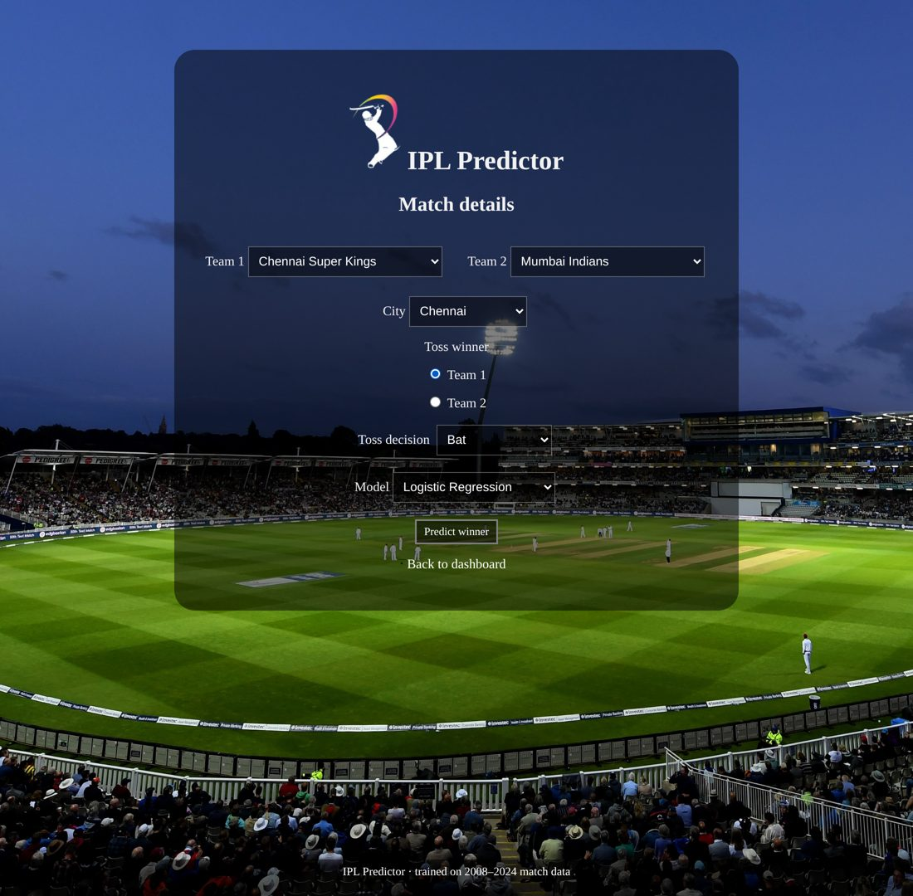
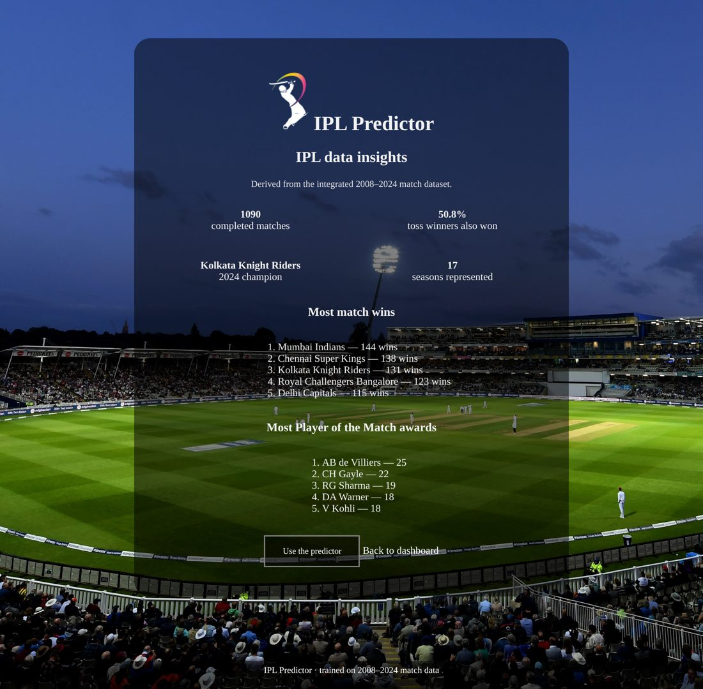

# IPL Intelligence: Match Analytics & Winner Prediction 🏏

A Flask web app that predicts the winner of an IPL match with **six machine-learning models**, trained on **1,095 matches from 2008–2024**. It includes user accounts and a data-insights dashboard.

<p align="center">
  
  
</p>

## Features
- **Accounts:** sign up and log in, with users stored in SQLite and passwords hashed (Werkzeug)
- **Prediction:** pick two teams, the city and the toss result, then choose one of six models:
  Logistic Regression · Decision Tree · Random Forest · KNN · Gaussian Naive Bayes · Linear Regression
- **Insights dashboard:** toss-win rate, most match wins, most Player of the Match awards, 2024 champion
- **Reproducible evaluation:** `python evaluate.py` prints the accuracy table below

## How it works
```
data/ipl_matches_2008_2024.csv  (1,095 matches)
        │  clean team names (e.g. Delhi Daredevils → Delhi Capitals)
        ▼
"Does Team 1 win?"  ── each match added twice, teams swapped,
        │               so the order the teams are entered in doesn't matter
        ▼
One-hot features → 6 scikit-learn Pipelines ──► Flask routes (/predict, /analytics)
                                                       │
                                         SQLite (user accounts)
```
Each model only ever chooses between the **two teams playing**. Features: team 1, team 2, city, toss winner, toss decision.

## Results
| Model | 5-fold CV accuracy | Trained ≤2021, tested on 2022–24 |
|---|---|---|
| Gaussian Naive Bayes | **56.1%** ± 4.6 | 51.4% |
| Linear Regression (thresholded) | 56.0% ± 3.6 | 49.5% |
| Logistic Regression | 55.4% ± 3.4 | 50.9% |
| Random Forest | 54.0% ± 4.6 | 46.3% |
| KNN | 52.8% ± 3.2 | 50.9% |
| Decision Tree | 47.9% ± 3.0 | 46.8% |
| *Baseline: toss winner wins* | *51.4%* | |

**Takeaway:** pre-match information (teams, venue, toss) only slightly beats the toss baseline, and the edge shrinks on recent seasons as squads change. Better predictions would need player-level form and in-match data. This is the next step for the project.

**Data insights (2008–2024):** toss winners won only **50.8%** of matches, and teams that won the toss and chose to field won 53.9% vs 45.4% when they chose to bat. Mumbai Indians lead with 144 wins.

## Run it
```bash
git clone https://github.com/DhanushBattu/IPL-Predictor-Analytics.git
cd IPL-Predictor-Analytics
pip install -r requirements.txt
python app.py          # open http://127.0.0.1:5000 and create an account
python evaluate.py     # reproduce the results table
```
On Windows you can also double-click `run.bat`.

## Project structure
```
app.py              Flask app: data loading, model training, routes
evaluate.py         Cross-validation and time-based test
data/               2008–2024 match dataset
v01/build/          Styles and images (plus the original PHP version, kept for reference)
docs/               Screenshots
```

## Tech
Python · Flask · Scikit-learn · Pandas · NumPy · SQLite · HTML/CSS

## Credits
Based on [Varun Bhattacharya's IPL_Predictor](https://github.com/VarunBhattacharya/IPL_Predictor) (GPL-3.0), originally a PHP/XAMPP app.

**My work:** rebuilt it as a self-contained Flask + SQLite app, extended the data to 2008–2024, rebuilt the six models as scikit-learn pipelines on a symmetric two-team target, added the evaluation script and the insights dashboard.

> Predictions are estimates from historical data, made for learning, not betting advice.

## License
GNU GPL v3.0, see [LICENSE.md](LICENSE.md).
